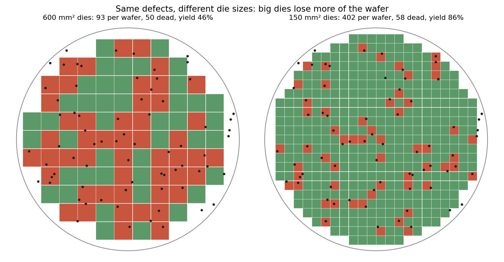
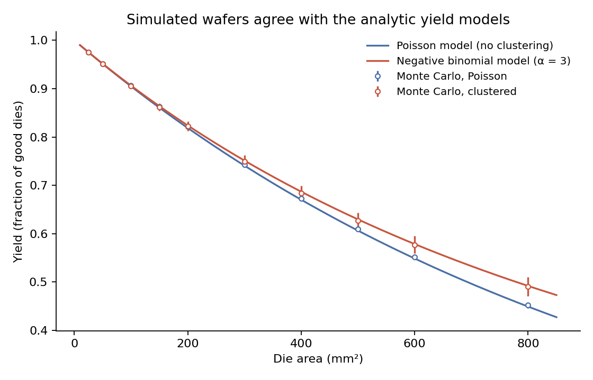
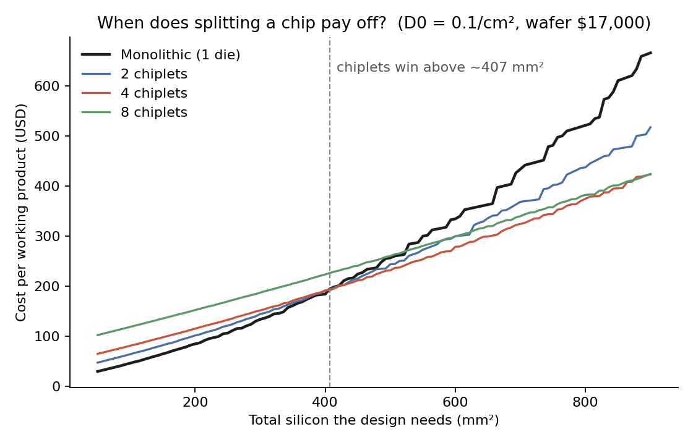
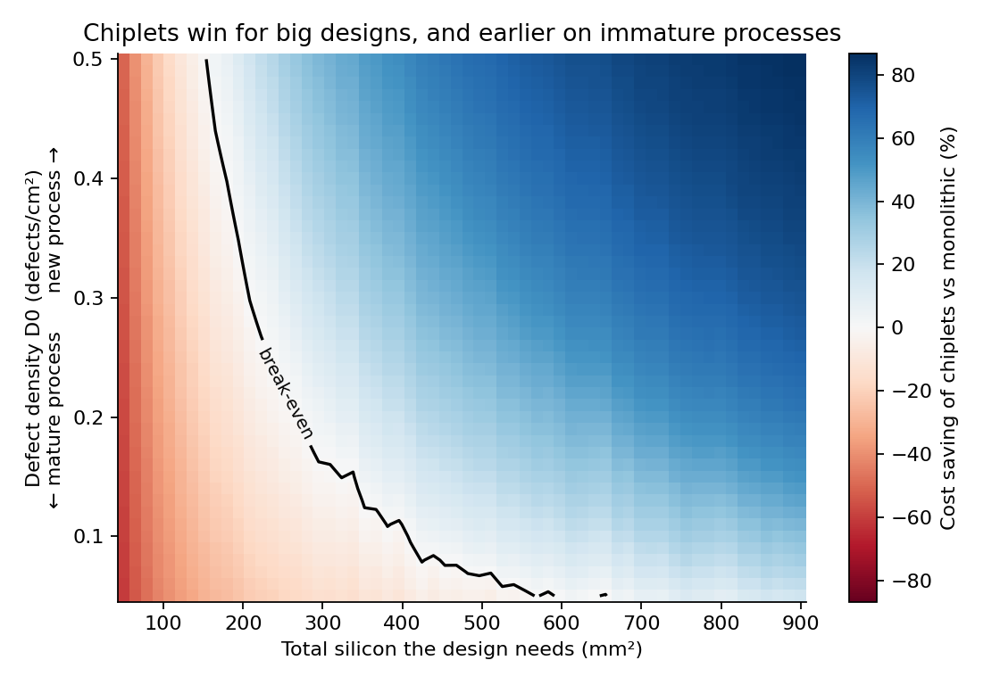

# Wafer Yield & Chiplet Economics

I built a simulator that drops random defects on a silicon wafer, counts how many chips survive, and uses that to work out when it's cheaper to split one big chip into smaller "chiplets".



## Why I built this

I got into semiconductors during placement season and started reading about how chips are actually made. One thing kept coming up: big chips are way more expensive than their size suggests, and companies like AMD started cutting their processors into smaller pieces. Coming from equity research, my first question was "okay, but what does that do to the cost?" I didn't want to just take it on trust, so I simulated it myself.

## The idea, simply

Chips are made hundreds at a time on a round silicon wafer. While they're being made, tiny defects (dust, flaws in the crystal) land at random spots. If a defect lands on a chip, that chip is dead.

The way I think about it: spill crumbs on a pizza. If you cut it into 4 big slices, a few crumbs ruin most of it. Cut it into 16 small slices and the same crumbs only ruin a few. The picture above is exactly that. The same 71 defects kill **54% of the wafer when the chips are 600 mm²**, but only **14% when they're 150 mm²**.

So why not always make small chips? Because splitting a chip isn't free. The pieces need extra circuitry to talk to each other, packaging several pieces costs more, and every time you attach a piece there's a chance it fails. I wanted to find the point where these two things balance out.

## What I built

1. **Fitting chips on the wafer.** Square chips on a round wafer leave gaps at the edge, and where you start the grid changes how many fit. So I try a bunch of grid positions and keep the one that fits the most complete chips.
2. **Dropping defects.** A random number of defects land at random spots. I also added the option to make some wafers dirtier than others, because that's how real fabs behave.
3. **Counting survivors.** Any chip with a defect on it is dead. I repeat this for hundreds of wafers and average it out to get the yield.
4. **Checking it against theory.** There are two standard formulas for yield. My simulation should match both, and it does.
5. **Working out cost.** Cost of a working product = cost of the good chips + packaging, adjusted for assembly failures. I compare one big chip against the same design split into 2, 4 and 8 chiplets.
6. **An interactive app.** A Streamlit dashboard where you can change the defect rate, chip size and packaging costs and see everything update.

## What I found

**The simulation matches the theory.** For chip sizes from 25 to 800 mm², my simulated yield is within 0.6% of the standard formulas. That's how I know the engine is doing the right thing.



**Chiplets aren't always cheaper.** This surprised me a bit. For small designs, one chip is cheaper. Chiplets only start winning above roughly 400 mm² of silicon. At 800 mm², splitting into 4 chiplets is about 28% cheaper.



**It depends on how mature the factory process is.** On a new process with more defects, chiplets already win at around 165 mm². On a very mature process, you need about 570 mm² before splitting is worth it. I think this is a big part of why chiplets matter most when companies move to a brand-new manufacturing technology.



## Things I had to think about

**Why do clustered defects make big chips yield *better*?** If defects bunch up, a lot of them land on chips that are already dead. A chip can only die once. If the same number of defects are spread evenly, they kill more chips.

**Why is the cost curve jagged?** The number of chips that fit on a wafer jumps in steps as the chip size changes (an extra row at the edge either fits or it doesn't). That's a real effect, not noise.

**Why not always split into 8 or 16?** Every extra piece adds interface area, packaging cost and one more chance for assembly to fail. After a point that costs more than the yield you gain.

**How much do I trust the dollar numbers?** Less than the overall pattern. Wafer cost, defect rate and packaging cost are assumptions (listed below). That's why I show how the result moves as the defect rate changes instead of quoting one number. The exact break-even shifts, but the fact that there *is* a break-even holds up.

## Assumptions (you can change all of these in the app)

| Parameter | Default | Note |
|---|---|---|
| Wafer size / unusable edge | 300 mm / 3 mm | standard |
| Gap between chips | 0.1 mm | where the wafer gets cut |
| Defect density | 0.10 per cm² | my assumption for a mature process |
| Clustering (α) | 3 | 2–3 is the commonly used range |
| Wafer cost | $17,000 | assumption; published estimates vary |
| Extra area per chiplet for connections | 10% | assumption |
| Packaging | $15 base + $8 per chiplet | assumption |
| Assembly success rate | 99% per chip attached | assumption |

## Run it yourself

```bash
pip install -r requirements.txt
python make_figures.py              # makes all the figures and figures/results.txt
python -m streamlit run app.py      # opens the interactive app
```

## What I want to add next

- Mixing manufacturing processes: the main chiplets on an expensive new process and the less critical part on a cheaper old one, which is what AMD actually does.
- Defects that form patterns (rings at the edge, scratches) instead of landing purely at random.
- Saving partly broken chips by switching off the bad core and selling them as a cheaper product.

## Files

- `yieldsim.py`: the engine (fitting chips, defects, yield, cost)
- `make_figures.py`: runs everything and saves the figures and numbers
- `app.py`: the interactive Streamlit app
